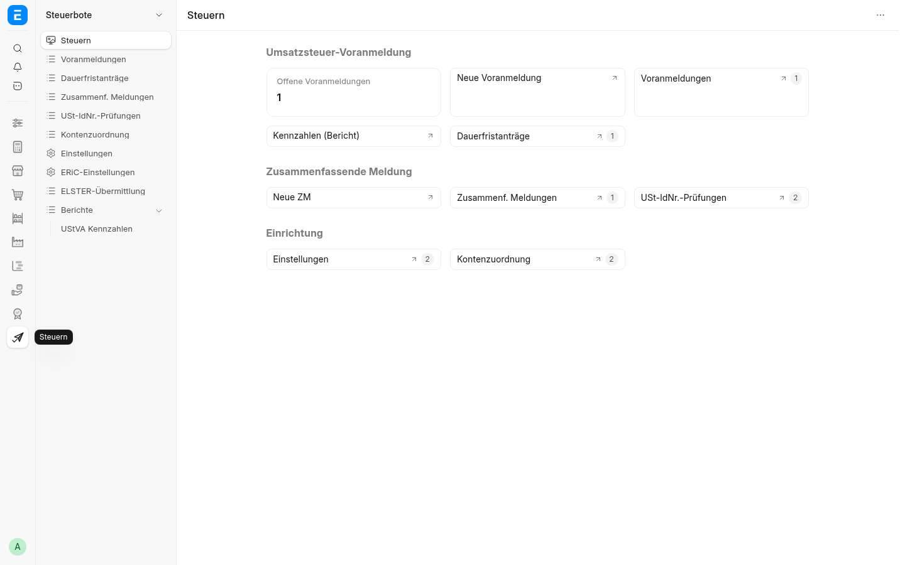
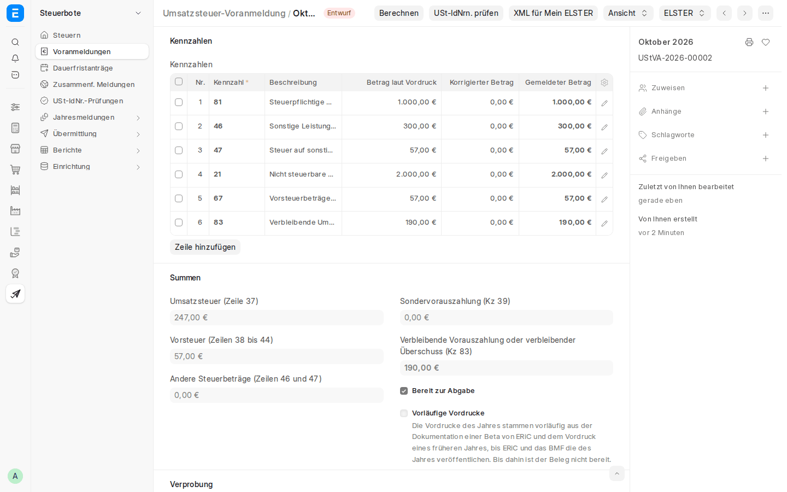
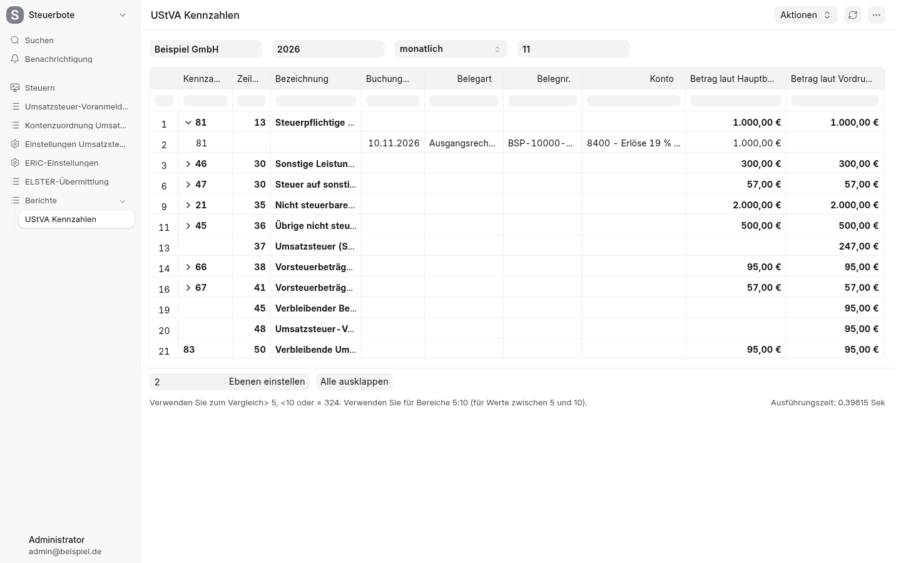
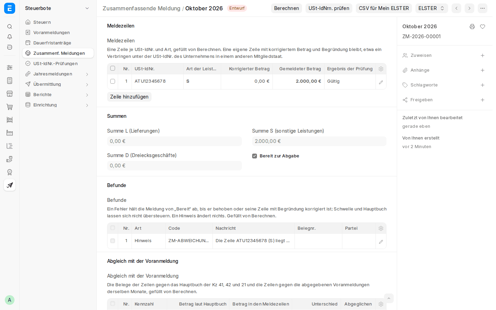
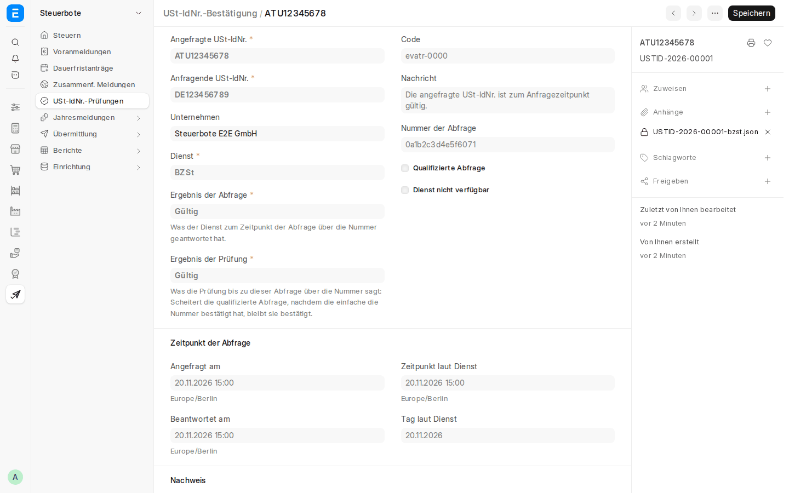

#  Steuerbote

Steuermeldungen aus ERPNext an ELSTER. Zuerst die Umsatzsteuer-Voranmeldung, danach Dauerfristverlängerung, Zusammenfassende Meldung und die Jahresmeldungen (E-Bilanz, Umsatzsteuer-, Körperschaftsteuer- und Gewerbesteuererklärung).

> **Status: in Entwicklung, noch nicht einsatzfähig.** Stufe 1 ist da: Rechenkern, Einstellungen, Kontenzuordnung, Meldung, Bericht und Druckformat der Umsatzsteuer-Voranmeldung, die XML-Datei für Mein ELSTER und die Anbindung an ERiC. Stufe 2 ist da: Die Zusammenfassende Meldung lässt sich berechnen, ihre USt-IdNrn. beim BZSt bestätigen, über ERiC übermitteln und als CSV-Datei in Mein ELSTER abgeben; die Dauerfristverlängerung berechnet die Sondervorauszahlung aus den abgegebenen Voranmeldungen des Vorjahres und übermittelt den Vordruck USt 1 H über ERiC. Ohne eigene Hersteller-ID läuft jede Übermittlung über ERiC nur als Simulation, und den Vordruck USt 1 H trägt man bis dahin in Mein ELSTER von Hand ein; die echte Übermittlung folgt mit der Hersteller-ID, siehe [Roadmap](docs/roadmap.md).


## Was Steuerbote macht

- **Kennzahlen aus dem Hauptbuch.** Die Umsatzsteuer-Voranmeldung wird aus den Buchungen (GL Entry) berechnet, nicht aus Rechnungen. Damit zählen auch Journalbuchungen und importierte Buchungsstapel, etwa aus Trading- oder Abrechnungssystemen.
- **Verprobung je Beleg.** Für jede Bemessungsgrundlage wird die rechnerische Steuer mit der gebuchten Steuer verglichen, Beleg für Beleg. Abweichende Belege halten die Meldung an, ebenso Salden auf beobachteten Konten: Konten, die zur Umsatzsteuer gehören, aber in den Vorgaben noch keine Kennzahl haben. Ein Konto der Stufe „Hinweis“, dessen Saldo nur manchmal in die Voranmeldung gehört, hält die Meldung nicht an, sein Saldo ergibt einen Hinweis.
- **Abgleich mit den Registern.** „Berechnen“ stellt die Summen der Berichte Sales Register und Purchase Register von ERPNext je Kennzahl und Steuerkonto neben die Beträge aus dem Hauptbuch. Eine Abweichung, etwa durch eine Journalbuchung auf einem Erlöskonto, braucht vor der Abgabe eine Erklärung.
- **Vorperiodenvergleich und Plausibilitätshinweise.** Jede Kennzahl steht neben Vorperiode und Vorjahr, und auffällige Änderungen, EU-Rechnungen ohne USt-IdNr., Rechnungen ohne passende Steuer und Rechnungen, die nicht zum Hauptbuch passen, bekommen einen Hinweis, der die Meldung nie anhält.
- **Rundung wie im Vordruck.** Bemessungsgrundlagen in vollen Euro (Cent werden abgeschnitten), Steuerbeträge mit Cent, so wie es die Anleitung zum Vordruck USt 1 A verlangt.
- **Kontenrahmen frei wählbar.** Vorgaben für SKR03 und SKR04 (Ausgabe 2026) liegen bei. Jedes Konto, das DATEV für die Umsatzsteuer kennzeichnet, ist darin zugeordnet, verprobt, beobachtet oder mit Grund bewusst ohne Kennzahl, einschließlich der Kontenbereiche und der Kontonummern aus den SKR-Vorlagen von ERPNext. Die Zuordnung Konto → Kennzahl arbeitet nur mit Kontonummern, deshalb laufen auch andere Kontenrahmen darüber. Jede Firma hat ihre eigene Kontenzuordnung, vorbelegt aus den Vorgaben. „Steuervorlagen prüfen“ nennt jedes Konto der Steuervorlagen ohne Platz in der Zuordnung und beobachtet es auf Wunsch, „Berechnen“ gibt zu jedem einen Hinweis.
- **Je Firma und Zeitraum.** Mehrere Firmen in einer ERPNext-Site mit eigenem Kontenrahmen, eigenem Voranmeldungszeitraum (Monat oder Quartal) und eigenem Zertifikat, das bei jeder Übermittlung eingegeben und nur für den laufenden Vorgang verschlüsselt zwischengespeichert (15 Minuten), nie dauerhaft wird. Die Kennzahlen gelten je Jahrgang des Vordrucks. Der erste ist 2026, frühere Jahre sind nicht geplant; jedes neue Jahr kommt als eigener Katalog dazu, und die Jahre davor bleiben meldbar.
- **Übermittlung über ERiC** (Simulation; echte Übermittlung mit Hersteller-ID). Prüfen gegen die ELSTER-Prüfregeln vor der Abgabe, Testsenden und Senden mit Organisationszertifikat, Übermittlungsprotokoll als PDF an der ELSTER-Übermittlung des Belegs, siehe [Übermittlung an ELSTER](docs/uebermittlung.md).
- **Abgabe ohne Hersteller-ID.** Die Voranmeldung als XML-Datei für den Import in Mein ELSTER, mit nachgerechneter Kz 83 und dem Zeichensatz von ELSTER; geprüft und abgesendet wird sie in Mein ELSTER, siehe [Abgabe über Mein ELSTER](docs/abgabe-mein-elster.md).
- **Zusammenfassende Meldung.** Meldezeilen je USt-IdNr. und Art aus den Belegen hinter Kz 41, 42 und 21, im Abgaberhythmus der Einstellungen samt Schwelle von 50.000 € und abgeglichen mit Hauptbuch und abgegebenen Voranmeldungen, auch als Berichtigung. Mit „Prüfen“, „Testsenden“ und „Senden“ geht sie über ERiC an das BZSt wie die Voranmeldung, bis zur Hersteller-ID als Simulation; bis dahin wird sie als CSV-Datei über den Import in Mein ELSTER abgegeben, siehe [Zusammenfassende Meldung](docs/zm.md).
- **USt-IdNr.-Prüfung.** „USt-IdNrn. prüfen“ lässt jede USt-IdNr. einer Zusammenfassenden Meldung und jede hinter Kz 41, 42 und 21 einer Voranmeldung beim Bundeszentralamt für Steuern (BZSt) bestätigen, bei VIES nur, wenn das BZSt nicht antworten kann, und speichert jede Abfrage mit ihrer Antwort als Nachweis. Eine ungültige oder unbestätigte Nummer hält die Zusammenfassende Meldung an, bis eine Korrektur der Zeile mit Begründung sie freigibt; an der Voranmeldung nennen Hinweise jede Nummer ohne, mit zu alter oder mit ungültiger Bestätigung. Geprüft wird aus diesen Belegen heraus, nicht schon an der Rechnung, siehe [Prüfung ausländischer USt-IdNrn.](docs/ust-idnr-pruefung.md).
- **Dauerfristverlängerung und Sondervorauszahlung.** Der Beleg „Dauerfristverlängerung“ hält den Vordruck USt 1 H eines Unternehmens für ein Jahr: den Antrag und bei monatlicher Abgabe die Anmeldung der Sondervorauszahlung. „Berechnen“ bildet aus den abgegebenen Voranmeldungen des Vorjahres die Grundlage und ein Elftel davon als Sondervorauszahlung (Kz 38), mit Fälligkeit; eine Grundlage von Hand mit Begründung ersetzt sie, etwa nach einer Gründung im laufenden Jahr. Den Vordruck schreibt Steuerbote als XML und übermittelt ihn mit „Prüfen“, „Testsenden“ und „Senden“ über ERiC wie die Voranmeldung; ohne Hersteller-ID trägt man ihn in Mein ELSTER von Hand ein, mit dem Druckformat als Vorlage, und vermerkt die Abgabe mit „In Mein ELSTER eingetragen“ oder „Als außerhalb abgegeben vermerken“. Die Abgabe schreibt Kz 38 in die Einstellungen, aus denen die letzte Voranmeldung des Jahres die Sondervorauszahlung in Kz 39 abzieht, siehe [Dauerfristverlängerung](docs/dauerfristverlaengerung.md).

## Einblick

Die Bilder zeigen Steuerbote 0.2.0 in einer Testumgebung mit ERPNext 16. Firma, Anschrift, Steuernummern, USt-IdNrn., Belegnummern und Geschäftspartner sind Beispielwerte. Ein Klick auf ein Bild öffnet es in voller Größe.

<table>
  <tr>
    <td align="center" valign="top">
      <a href="docs/bilder/workspace-steuern.png"></a><br>
      Arbeitsbereich Steuern
    </td>
    <td align="center" valign="top">
      <a href="docs/bilder/voranmeldung.png"></a><br>
      Voranmeldung mit Hinweisen und Vorperiodenvergleich
    </td>
  </tr>
  <tr>
    <td align="center" valign="top">
      <a href="docs/bilder/bericht-kennzahlen.png"></a><br>
      Bericht mit den Belegen je Kennzahl
    </td>
    <td align="center" valign="top">
      <a href="docs/bilder/zusammenfassende-meldung.png"></a><br>
      Zusammenfassende Meldung mit Befunden
    </td>
  </tr>
  <tr>
    <td align="center" valign="top">
      <a href="docs/bilder/ust-idnr-bestaetigung.png"></a><br>
      USt-IdNr.-Bestätigung als Nachweis
    </td>
    <td align="center" valign="top">
      <a href="docs/bilder/dauerfristverlaengerung.png"></a><br>
      Dauerfristverlängerung
    </td>
  </tr>
</table>

## Voraussetzungen

- Frappe und ERPNext ab Version 16. Unterstützt wird nur die jeweils aktuelle Hauptversion.
- Python 3.14.
- Für die Übermittlung: ERiC (ELSTER Rich Client) der Finanzverwaltung auf Linux x86_64 und ein ELSTER-Organisationszertifikat. ERiC darf ein Softwarehersteller nur als Teil seines eigenen Produkts weitergeben, nicht weiterlizenzieren; Steuerbote liefert es deshalb nicht mit, jeder Betreiber lädt es selbst aus dem ELSTER-Entwicklerbereich und richtet es ein, siehe [ERiC](docs/eric.md).

## Installation

```bash
cd $PATH_TO_YOUR_BENCH
bench get-app https://github.com/encircle360-oss/steuerbote
bench --site <site> install-app steuerbote
```

### Als Teil von erpnext_germanized

[erpnext_germanized](https://github.com/encircle360-oss/erpnext_germanized) ist ein fertiges Container-Image mit ERPNext 16 und den gängigen deutschen Apps, versioniert in der GitHub Container Registry. Steuerbote ist darin bereits enthalten; wer ERPNext neu aufsetzt oder im Container betreibt, braucht die Schritte oben nicht.

### Wo finde ich Steuerbote?

In der Leiste links, bei den Bereichen von ERPNext wie Rechnungswesen und Vertrieb, steht „Steuern“. Der Eintrag öffnet den Arbeitsbereich „Steuern“ mit den Voranmeldungen, den Dauerfristverlängerungen, den Zusammenfassenden Meldungen, dem Bericht „UStVA Kennzahlen“ und den Einstellungen. Ihn sehen Benutzer mit einer der Rollen Accounts User, Accounts Manager oder System Manager.

- Wer die Leiste für alle oder für sich angeordnet hat, bekommt „Steuern“ nicht von selbst dazu, sondern nimmt den Eintrag im Benutzermenü über „Dock verwalten“ auf.
- In der App-Übersicht steht Steuerbote nicht als eigene Kachel, weil es sich in die Leiste von ERPNext einhängt. Als Standard-App eines Benutzers lässt es sich trotzdem wählen. Mehr dazu in [Architektur](docs/architektur.md#platz-im-desk).

## Dokumentation

- [Roadmap](docs/roadmap.md): Arbeitspakete und Reihenfolge
- [Einrichtung](docs/einrichtung.md): „Steuerbote einrichten“ legt je Unternehmen Einstellungen und Kontenzuordnung an und schlägt den Voranmeldungszeitraum vor, mit Hook für weitere Schritte
- [Umsatzsteuer-Voranmeldung: Kennzahlen und Kontenzuordnung](docs/ustva-kennzahlen.md): Quelle, Rundung, Kennzahlen, Vorgaben für SKR03 und SKR04, Fristen und die Einschätzung zur Ist-Versteuerung
- [Abgabe über Mein ELSTER](docs/abgabe-mein-elster.md): XML-Datei erzeugen und in Mein ELSTER importieren
- [Zusammenfassende Meldung](docs/zm.md): Meldezeiträume, Abgaberhythmus, Meldezeilen, Abgleich mit der Voranmeldung, Berichtigung, CSV-Datei für Mein ELSTER und der Beleg in ERPNext
- [Prüfung ausländischer USt-IdNrn.](docs/ust-idnr-pruefung.md): Bestätigung beim BZSt, VIES als Ausweichdienst und die gespeicherten Abfragen
- [Dauerfristverlängerung und Sondervorauszahlung](docs/dauerfristverlaengerung.md): Regeln, Fristen, Vordruck USt 1 H mit XML und Übermittlung über ERiC, der Beleg in ERPNext und der Eintrag in Mein ELSTER
- [Architektur](docs/architektur.md): Rechenkern und Frappe-Schicht, DocTypes, Bericht, Arbeitsbereich, Platz im Desk und Druckformat
- [Übermittlung an ELSTER](docs/uebermittlung.md): Prüfen, Testsenden, Senden, Simulationsmodus, ERiC-Einstellungen und Übermittlungsprotokoll
- [ERiC](docs/eric.md): Lizenz, Einrichtung durch den Betreiber, Versionen, Betrieb und Updates mit der wöchentlichen Prüfung gegen die Mindestversionsliste, Simulation, Sicherheit und Grenzen der Anbindung
- [Entwicklung](docs/entwicklung.md): Einrichtung, Tests, Stil
- [Mitwirken](CONTRIBUTING.md), [Hinweise für Coding-Agenten](AGENTS.md), [Sicherheit](SECURITY.md)

## Mitwirken und Community

### Beiträge sind willkommen

Steuerbote lebt davon, dass Menschen mit unterschiedlichen Kontenrahmen, Branchen und Steuerfällen mitmachen. Du kannst

- **Maintainer werden**, für einen Bereich (etwa einen Kontenrahmen oder eine Meldung) oder das ganze Projekt,
- **Pull Requests** für Fehlerbehebungen, Funktionen und Dokumentation stellen,
- **testen**, besonders mit anderen Kontenrahmen und Steuerfällen als unseren,
- **Dokumentation und Beispiele** verbessern,
- **Fehler melden** oder Funktionen vorschlagen.

Jeder Beitrag zählt. Du musst kein Steuerprofi sein, wir helfen beim Einstieg.

### So geht es

1. Repository forken und einen Branch anlegen
2. Änderung samt Tests schreiben (Test zuerst, siehe [Mitwirken](CONTRIBUTING.md))
3. Lokal prüfen: `pre-commit run --all-files` und `pytest`
4. Pull Request mit kurzer Beschreibung und Quelle der fachlichen Regel stellen
5. Review gemeinsam durchgehen, bis es passt

### Maintainer werden

Wer dauerhaft Verantwortung übernehmen möchte, zeigt das am einfachsten durch Pull Requests und Hilfe in Issues und Discussions und schreibt dann an **oss@encircle360.com**. Ein Bereich reicht, es muss nicht das ganze Projekt sein.

## Support und professionelle Dienstleistungen

### Community-Support

- **Matrix:** [#oss:encircle360.com](https://matrix.to/#/#oss:encircle360.com) für den direkten Austausch mit Maintainern und Nutzern
- **Issues:** [Fehler und Wünsche zu Steuerbote](https://github.com/encircle360-oss/steuerbote/issues)
- **Discussions:** [Fragen und fachlicher Austausch](https://github.com/encircle360-oss/steuerbote/discussions)
- **Fehler in ERPNext oder Frappe selbst** bitte beim jeweiligen Projekt melden: [frappe/erpnext](https://github.com/frappe/erpnext/issues), [frappe/frappe](https://github.com/frappe/frappe/issues)

### Professioneller Support

Für Einführung, Anpassung an eigene Kontenrahmen, Betrieb, Schulung oder die Begleitung der Einrichtung zusammen mit deiner Steuerberatung: **hello@encircle360.com**

## Haftungsausschluss

Steuerbote wird „wie besehen“ („AS IS“) und ohne jede Gewährleistung bereitgestellt, weder ausdrücklich noch stillschweigend, einschließlich, aber nicht beschränkt auf die Gewährleistung der Marktgängigkeit, der Eignung für einen bestimmten Zweck und der Nichtverletzung von Rechten Dritter.

Steuerbote ist Software, keine Steuerberatung. Mit der Nutzung erkennst du an:

- Du nutzt Steuerbote auf eigenes Risiko. Für jede Steueranmeldung bleibst du selbst verantwortlich, für ihre Richtigkeit, Vollständigkeit und fristgerechte Abgabe.
- Berechnungen, Kontenzuordnungen, Validierungen und Übermittlungen können Fehler enthalten, auch wenn alle Prüfungen grün sind. Prüfe jede Meldung vor der Abgabe und lass die Einrichtung von deiner Steuerberatung bestätigen.
- Gesetze, Vordrucke und ELSTER-Schnittstellen ändern sich. Steuerbote kann dem hinterherhinken.
- Die Maintainer, die encircle360 GmbH und alle Mitwirkenden haften nicht für Schäden oder Verluste jeder Art, die aus der Nutzung oder der Unmöglichkeit der Nutzung entstehen, insbesondere nicht für Steuernachzahlungen, Zinsen, Verspätungs- oder Säumniszuschläge, Bußgelder, verlorene Vorsteuer oder die Kosten einer Nachbearbeitung. Das gilt, soweit ein Haftungsausschluss gesetzlich zulässig ist.
- Steuerbote ist kein Angebot der Finanzverwaltung. ELSTER und ERiC sind Verfahren und Software der Steuerverwaltungen der Länder und des Bundes, Frappe und ERPNext Projekte der Frappe Technologies Pvt. Ltd. Steuerbote steht mit keinem davon in Verbindung.

Für den Einsatz mit zugesichertem Support und Reaktionszeiten sprich uns an: **hello@encircle360.com**

## Lizenz

Steuerbote steht unter der [GNU Affero General Public License v3.0 oder später](LICENSE) (AGPL-3.0-or-later). Sie ist mit der GPL-3.0 von ERPNext kompatibel. ERiC ist nicht Teil dieses Repositories und unterliegt den Nutzungsbedingungen der Finanzverwaltung.

## Maintainer

Steuerbote wird von der **[encircle360 GmbH](https://encircle360.com)** entwickelt und gepflegt.

## Credits und Mitwirkende

Danke an alle Mitwirkenden, Partner und die Open-Source-Community, insbesondere an das [Frappe/ERPNext-Projekt](https://github.com/frappe/erpnext), auf dem Steuerbote aufsetzt. Alle Mitwirkenden stehen in der [Contributors-Liste](https://github.com/encircle360-oss/steuerbote/graphs/contributors).
