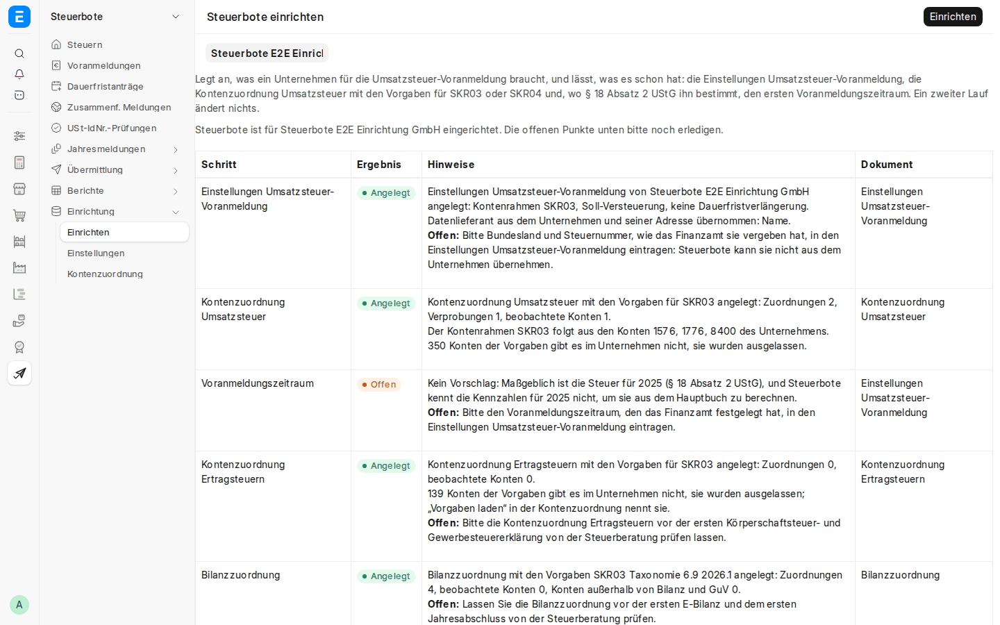
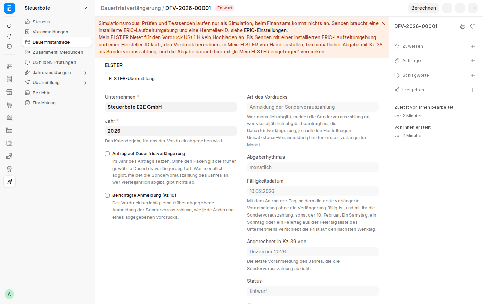
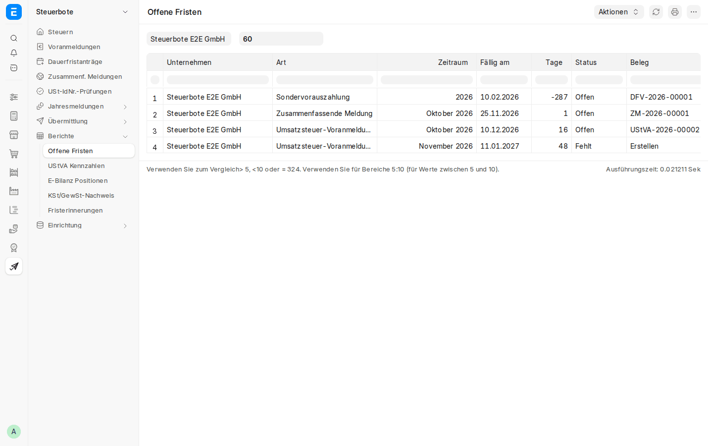
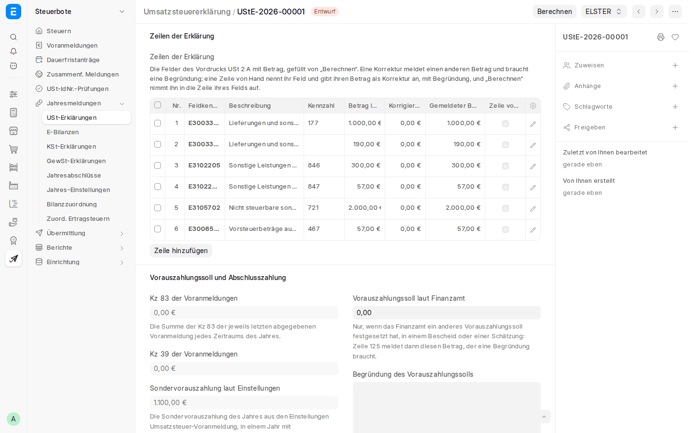
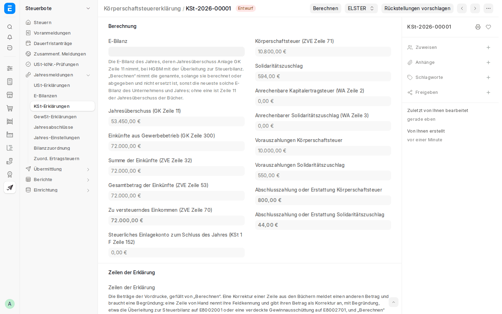
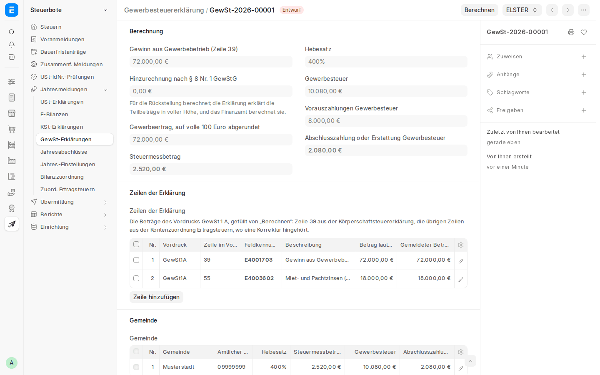
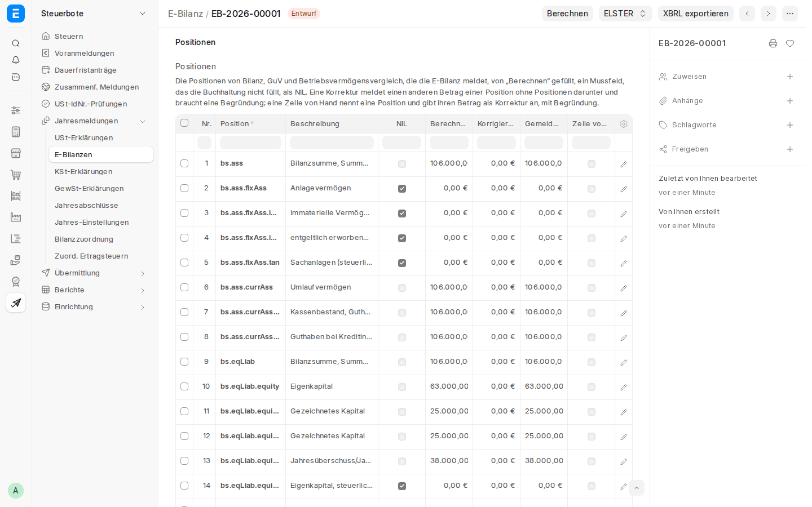
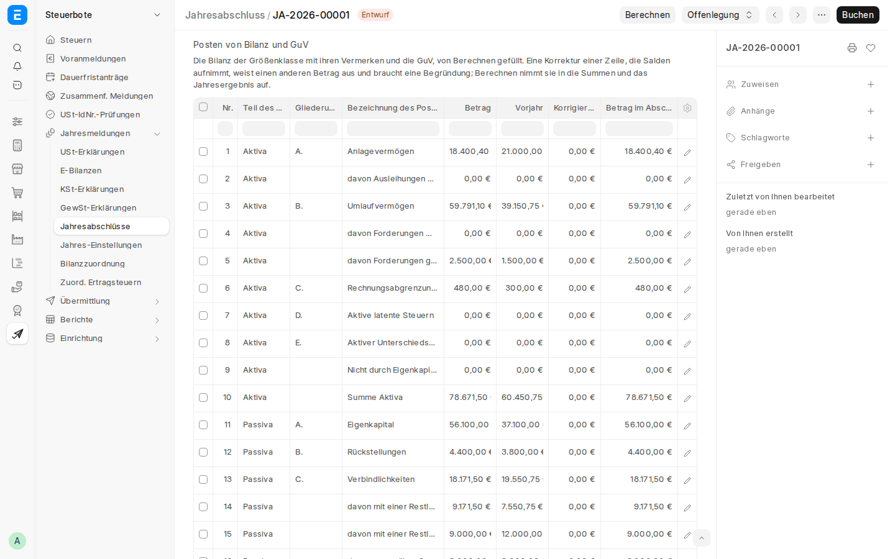
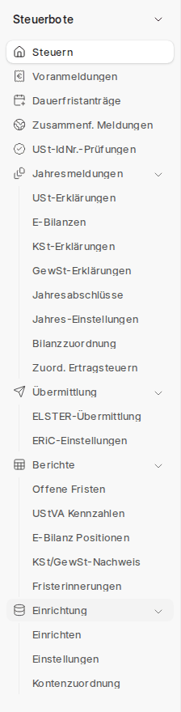

#  Steuerbote

Steuermeldungen aus ERPNext an ELSTER: Umsatzsteuer-Voranmeldung, Dauerfristverlängerung, Zusammenfassende Meldung, Umsatzsteuer-, Körperschaftsteuer- und Gewerbesteuererklärung, E-Bilanz und Jahresabschluss mit Offenlegung für das Unternehmensregister. Steuerbote berechnet sie aus den Buchungen in ERPNext, prüft sie vor der Abgabe und übermittelt sie über ERiC; den Jahresabschluss lädt das Unternehmen mit der Datei von Steuerbote selbst beim Unternehmensregister hoch.

> **Status: in Entwicklung, noch nicht einsatzfähig.** Stufe 1 ist da: Rechenkern, Einstellungen, Kontenzuordnung, Meldung, Bericht und Druckformat der Umsatzsteuer-Voranmeldung, die XML-Datei für Mein ELSTER und die Anbindung an ERiC. Stufe 2 ist da: Die Zusammenfassende Meldung lässt sich berechnen, ihre USt-IdNrn. beim BZSt bestätigen, über ERiC übermitteln und als CSV-Datei in Mein ELSTER abgeben; die Dauerfristverlängerung berechnet die Sondervorauszahlung aus den abgegebenen Voranmeldungen des Vorjahres und übermittelt den Vordruck USt 1 H über ERiC. Von Stufe 3, den Jahresmeldungen, sind alle fünf Belege da: Die Umsatzsteuererklärung 2026 lässt sich aus dem Hauptbuch berechnen, mit den abgegebenen Voranmeldungen abgleichen, drucken und als Datenart USt über ERiC übermitteln; die Körperschaft- und die Gewerbesteuererklärung 2026 lassen sich berechnen und drucken, vorläufig mit den Vordrucken von 2025, bis ELSTER die von 2026 veröffentlicht; die E-Bilanz entsteht aus Hauptbuch, Anlagen und Bilanzzuordnung und geht als Datenart Bilanz über ERiC; der Jahresabschluss entsteht aus Hauptbuch und Bilanzzuordnung, hält die Feststellung fest und gibt einer Kleinstkapitalgesellschaft oder kleinen Gesellschaft die XBRL-Datei, die sie selbst beim Unternehmensregister hochlädt. Die fünf Belege greifen ineinander: Die E-Bilanz gibt der Körperschaftsteuererklärung den Jahresüberschuss und vergleicht ihre Handelsbilanz mit dem Jahresabschluss, und die Umsatzsteuererklärung gibt einen Hinweis, wenn ihre Umsätze nicht zu den Umsatzerlösen passen. Voranmeldung und Vordruck USt 1 H 2027 kennt Steuerbote vorläufig aus der Dokumentation der Beta ERiC 45.1.5.0: Sie lassen sich berechnen, prüfen und testsenden, werden aber nicht „Bereit“ und gehen nur mit Begründung ab, bis ERiC 45 freigegeben ist und das BMF-Schreiben mit den Vordrucken 2027 vorliegt. Die HGB-Taxonomie 6.10 steht neben 6.9 bereit; Echtfälle damit nimmt ERiC erst mit ERiC 46 an. Ohne eigene Hersteller-ID läuft jede Übermittlung über ERiC nur als Simulation: Den Vordruck USt 1 H und die Erklärungen trägt man bis dahin nach dem Druckformat in Mein ELSTER von Hand ein; eine E-Bilanz nimmt Mein ELSTER nicht an, ihre XBRL-Datei geht dann an die Steuerberatung. Den Stand jedes Pakets nennt die [Roadmap](docs/roadmap.md).


## Was Steuerbote macht

- **Kennzahlen aus dem Hauptbuch.** Die Umsatzsteuer-Voranmeldung wird aus den Buchungen (GL Entry) berechnet, nicht aus Rechnungen. Damit zählen auch Journalbuchungen und importierte Buchungsstapel, etwa aus Trading- oder Abrechnungssystemen.
- **Verprobung je Beleg.** Für jede Bemessungsgrundlage wird die rechnerische Steuer mit der gebuchten Steuer verglichen, Beleg für Beleg. Abweichende Belege halten die Meldung an, ebenso Salden auf beobachteten Konten: Konten, die zur Umsatzsteuer gehören, aber in den Vorgaben noch keine Kennzahl haben. Ein Konto der Stufe „Hinweis“, dessen Saldo nur manchmal in die Voranmeldung gehört, hält die Meldung nicht an, sein Saldo ergibt einen Hinweis.
- **Abgleich mit den Registern.** „Berechnen“ stellt die Summen der Berichte Sales Register und Purchase Register von ERPNext je Kennzahl und Steuerkonto neben die Beträge aus dem Hauptbuch. Eine Abweichung, etwa durch eine Journalbuchung auf einem Erlöskonto, braucht vor der Abgabe eine Erklärung.
- **Vorperiodenvergleich und Plausibilitätshinweise.** Jede Kennzahl steht neben Vorperiode und Vorjahr, und auffällige Änderungen, EU-Rechnungen ohne USt-IdNr., Rechnungen ohne passende Steuer und Rechnungen, die nicht zum Hauptbuch passen, bekommen einen Hinweis, der die Meldung nie anhält.
- **Rundung wie im Vordruck.** Bemessungsgrundlagen in vollen Euro (Cent werden abgeschnitten), Steuerbeträge mit Cent, so wie es die Anleitung zum Vordruck USt 1 A verlangt.
- **Kontenrahmen frei wählbar.** Vorgaben für SKR03 und SKR04 (Ausgabe 2026) liegen bei. Jedes Konto, das DATEV für die Umsatzsteuer kennzeichnet, ist darin zugeordnet, verprobt, beobachtet oder mit Grund bewusst ohne Kennzahl, einschließlich der Kontenbereiche und der Kontonummern aus den SKR-Vorlagen von ERPNext. Die Zuordnung Konto → Kennzahl arbeitet nur mit Kontonummern, deshalb laufen auch andere Kontenrahmen darüber. Jede Firma hat ihre eigene Kontenzuordnung, vorbelegt aus den Vorgaben. „Steuervorlagen prüfen“ nennt jedes Konto der Steuervorlagen ohne Platz in der Zuordnung und beobachtet es auf Wunsch, „Berechnen“ gibt zu jedem einen Hinweis.
- **Je Firma und Zeitraum.** Mehrere Firmen in einer ERPNext-Site mit eigenem Kontenrahmen, eigenem Voranmeldungszeitraum (Monat oder Quartal) und eigenem Zertifikat, das bei jeder Übermittlung eingegeben und nur für den laufenden Vorgang verschlüsselt zwischengespeichert (15 Minuten), nie dauerhaft wird. Die Kennzahlen gelten je Jahrgang des Vordrucks. Der erste ist 2026, frühere Jahre sind nicht geplant; 2027 kennt Steuerbote vorläufig aus der Dokumentation der Beta ERiC 45.1.5.0. Jedes neue Jahr kommt als eigener Katalog dazu, und die Jahre davor bleiben meldbar.
- **Übermittlung über ERiC** (Simulation; echte Übermittlung mit Hersteller-ID). Prüfen gegen die ELSTER-Prüfregeln vor der Abgabe, Testsenden und Senden mit Organisationszertifikat, Übermittlungsprotokoll oder, nach dem Senden einer Erklärung, Freizeichnungsdokument als PDF an der ELSTER-Übermittlung des Belegs, siehe [Übermittlung an ELSTER](docs/uebermittlung.md).
- **Abgabe ohne Hersteller-ID.** Die Voranmeldung als XML-Datei für den Import in Mein ELSTER, mit nachgerechneter Kz 83 und dem Zeichensatz von ELSTER; geprüft und abgesendet wird sie in Mein ELSTER, siehe [Abgabe über Mein ELSTER](docs/abgabe-mein-elster.md).
- **Zusammenfassende Meldung.** Meldezeilen je USt-IdNr. und Art aus den Belegen hinter Kz 41, 42 und 21, im Abgaberhythmus der Einstellungen samt Schwelle von 50.000 € und abgeglichen mit Hauptbuch und abgegebenen Voranmeldungen, auch als Berichtigung. Mit „Prüfen“, „Testsenden“ und „Senden“ geht sie über ERiC an das BZSt wie die Voranmeldung, bis zur Hersteller-ID als Simulation; bis dahin wird sie als CSV-Datei über den Import in Mein ELSTER abgegeben, siehe [Zusammenfassende Meldung](docs/zm.md).
- **USt-IdNr.-Prüfung.** „USt-IdNrn. prüfen“ lässt jede USt-IdNr. einer Zusammenfassenden Meldung und jede hinter Kz 41, 42 und 21 einer Voranmeldung beim Bundeszentralamt für Steuern (BZSt) bestätigen, bei VIES nur, wenn das BZSt nicht antworten kann, und speichert jede Abfrage mit ihrer Antwort als Nachweis. Eine ungültige oder unbestätigte Nummer hält die Zusammenfassende Meldung an, bis eine Korrektur der Zeile mit Begründung sie freigibt; an der Voranmeldung nennen Hinweise jede Nummer ohne, mit zu alter oder mit ungültiger Bestätigung. Geprüft wird aus diesen Belegen heraus, nicht schon an der Rechnung, siehe [Prüfung ausländischer USt-IdNrn.](docs/ust-idnr-pruefung.md).
- **Dauerfristverlängerung und Sondervorauszahlung.** Der Beleg „Dauerfristverlängerung“ hält den Vordruck USt 1 H eines Unternehmens für ein Jahr: den Antrag und bei monatlicher Abgabe die Anmeldung der Sondervorauszahlung. „Berechnen“ bildet aus den abgegebenen Voranmeldungen des Vorjahres die Grundlage und ein Elftel davon als Sondervorauszahlung (Kz 38), mit Fälligkeit; eine Grundlage von Hand mit Begründung ersetzt sie, etwa nach einer Gründung im laufenden Jahr. Den Vordruck schreibt Steuerbote als XML und übermittelt ihn mit „Prüfen“, „Testsenden“ und „Senden“ über ERiC wie die Voranmeldung; ohne Hersteller-ID trägt man ihn in Mein ELSTER von Hand ein, mit dem Druckformat als Vorlage, und vermerkt die Abgabe mit „In Mein ELSTER eingetragen“ oder „Als außerhalb abgegeben vermerken“. Die Abgabe schreibt Kz 38 in die Einstellungen, aus denen die letzte Voranmeldung des Jahres die Sondervorauszahlung in Kz 39 abzieht, siehe [Dauerfristverlängerung](docs/dauerfristverlaengerung.md).
- **Fristen.** Der Bericht „Offene Fristen“ und eine tägliche E-Mail nennen die Fristen von Voranmeldung, Zusammenfassender Meldung und Sondervorauszahlung und, mit den Einstellungen Jahresmeldungen, die der Umsatzsteuer-, Körperschaftsteuer- und Gewerbesteuererklärung und der E-Bilanz, für 2026 den 2. August 2027 und mit Steuerberatung den 29. Februar 2028, und die der Feststellung und Offenlegung des Jahresabschlusses, jede mit dem Stand ihres Belegs, siehe [Fristen](docs/fristen.md).
- **Steuerbote einrichten.** Ein Lauf legt für ein Unternehmen die Einstellungen Umsatzsteuer-Voranmeldung, die Kontenzuordnung Umsatzsteuer mit den Vorgaben für SKR03 oder SKR04, die Kontenzuordnung Ertragsteuern und die Bilanzzuordnung, beide ebenfalls mit ihren Vorgaben für SKR03 oder SKR04, an, schlägt den ersten Voranmeldungszeitraum vor, wo § 18 Abs. 2 UStG ihn bestimmt, und sagt, was offen bleibt. „Vorgaben aktualisieren“ zeigt die Unterschiede zwischen den gelieferten Vorgaben und der eigenen Zuordnung und übernimmt nur, was man auswählt; jede Zuordnung lässt sich als Datei exportieren und in ein anderes Unternehmen oder eine andere Site importieren, siehe [Einrichtung](docs/einrichtung.md).
- **Einstellungen Jahresmeldungen.** Je Unternehmen, was die Jahresmeldungen über das Hauptbuch hinaus brauchen: Rechtsform, Sitz, Handelsregister, Anschrift, Steuerberatung, Angaben je Jahr, Anteilseigner, Geschäftsführer, Betriebsstätten mit Hebesätzen, Beteiligungen, Vorauszahlungen, festgestellte Vorträge und Größenmerkmale. Die Nummern der Anteilseigner, etwa ihre Identifikationsnummer, sehen nur Accounts Manager und System Manager.
- **Umsatzsteuererklärung.** Der Beleg „Umsatzsteuererklärung“ füllt den Vordruck USt 2 A 2026 aus dem Hauptbuch des Jahres; die Kontenzuordnung gibt jedem Konto seine Zeile der Erklärung, mit Vorgaben für SKR03 und SKR04. „Berechnen“ stellt das Vorauszahlungssoll aus den abgegebenen Voranmeldungen und der Sondervorauszahlung gegenüber, gleicht Zeitraum für Zeitraum und Kennzahl für Kennzahl mit den Voranmeldungen ab und hält die Erklärung an, solange ein Zeitraum ohne abgegebene Voranmeldung und ohne Begründung bleibt oder der Abgleich einen unerklärten Rest hat. Prüfen, Testsenden und Senden laufen als Datenart USt über ERiC, bis zur Hersteller-ID als Simulation; Mein ELSTER importiert keine Umsatzsteuererklärung, deshalb dient das Druckformat zum Eintragen, siehe [Umsatzsteuererklärung](docs/umsatzsteuererklaerung.md).
- **Körperschaft- und Gewerbesteuererklärung.** Die Belege „Körperschaftsteuererklärung“ und „Gewerbesteuererklärung“ rechnen aus der Gewinn- und Verlustrechnung des Wirtschaftsjahres, der Kontenzuordnung Ertragsteuern und den Einstellungen Jahresmeldungen die Vordrucke KSt 1, GK, ZVE, Z, Verluste, WA, KSt 1 F, GewSt 1 A und BEG, mit § 8b KStG, Verlustabzug, steuerlichem Einlagekonto, Hinzurechnungen und Kürzungen; die Gewerbesteuer baut auf der Körperschaftsteuer desselben Jahres auf. Die Kontenzuordnung Ertragsteuern bringt Vorgaben für SKR03 und SKR04 aus den Kennzeichen K und G der DATEV-Kontenrahmen 2026; Konten mit Handelsergebnissen bekommen keine, ihre Klasse setzt die Steuerberatung. „Rückstellungen vorschlagen“ legt die Rückstellungen der drei Steuern als Journalbuchung im Entwurf an, gebucht wird nichts, und der Bericht „Ertragsteuer-Kontennachweis“ führt jede Zeile zu ihren Buchungen. Die Vordrucke 2026 sind vorläufig die der Jahresdokumentationen 2025: Bis ELSTER die von 2026 veröffentlicht, wird eine Erklärung 2026 nicht „Bereit“ und lässt sich nur mit Anmerkungen abgeben. „Bereit“ verlangt außerdem den Tag, an dem eine Steuerberatung die Prüfliste bestätigt hat, siehe [Körperschaftsteuer- und Gewerbesteuererklärung](docs/ertragsteuern.md).
- **Bilanzzuordnung.** Die Bilanzzuordnung ordnet je Unternehmen jedes Konto einer Position der HGB-Taxonomie 6.9 zu, für E-Bilanz und Jahresabschluss zugleich, und prüft sie gegen die Taxonomie, die der Betreiber mit „Taxonomie einrichten“ in den ERiC-Einstellungen einrichtet. Ihre Vorgaben für SKR03 und SKR04 geben jedem Konto und Kontenbereich, den die DATEV-Kontenrahmen 2026 beschriften, und jedem Konto der Vorlagen von ERPNext einen Platz, eine Position, beobachtet oder außerhalb von Bilanz und GuV, und, wo die Bezeichnungen die Wahl nicht allein tragen, einen Grund mit Quelle. „Konten prüfen“ nennt jedes Konto ohne Platz, siehe [Vorgaben der Bilanzzuordnung](docs/ebilanz-zuordnung.md) und [HGB-Taxonomie](docs/taxonomie.md).
- **E-Bilanz.** Der Beleg „E-Bilanz“ berechnet je Unternehmen, Jahr und Bilanzart, Jahresabschluss oder Eröffnungsbilanz des Gründungsjahres, die E-Bilanz nach § 5b EStG aus Hauptbuch, Anlagen, Bilanzzuordnung und Einstellungen Jahresmeldungen: Positionen mit Kontensalden, Anlagenspiegel, bei einer Handelsbilanz mit Überleitungsrechnung die Steuerbilanz, Betriebsvermögensvergleich und Stammdaten. „Bereit“ verlangt unter anderem die eingerichtete Taxonomie, einen Platz für jeden Saldo und die bis zum Stichtag gebuchten Abschreibungen. Prüfen, Testsenden und Senden laufen als Datenart Bilanz über ERiC, bis zur Hersteller-ID als Simulation; Mein ELSTER nimmt keine E-Bilanz an, deshalb geht die Datei von „XBRL exportieren“ an die Steuerberatung, und „Als außerhalb abgegeben vermerken“ hält die Abgabe fest. Dazu kommen das Druckformat „E-Bilanz“ und der Bericht „E-Bilanz Positionen“, siehe [E-Bilanz](docs/ebilanz.md).
- **Jahresabschluss und Offenlegung.** Der Beleg „Jahresabschluss“ einer GmbH oder UG entsteht aus dem Hauptbuch über die Bilanzzuordnung: die Größenklasse aus den Merkmalen beider Stichtage mit den Arbeitnehmern je Quartalsende, die Bilanz nach § 266 HGB und die Gewinn- und Verlustrechnung nach dem Gesamtkostenverfahren mit Vorjahr, die Angaben unter der Bilanz oder im Anhang und die Unterzeichner. „Buchen“ ist die Feststellung, „Ergebnisverwendung buchen“ legt danach die Journalbuchung im Entwurf an. Für eine Kleinstkapitalgesellschaft oder kleine Gesellschaft zeigt die „Vorschau der Offenlegung“, was das Unternehmensregister sichtbar macht, „XBRL für das Unternehmensregister“ schreibt die Datei, die das Unternehmen selbst auf der Publikations-Plattform hochlädt, und „Übermittlung festhalten“ und „Einstellung festhalten“ halten fest, was das Register antwortet, siehe [Jahresabschluss](docs/jahresabschluss.md) und [Offenlegung](docs/offenlegung.md).

## Einblick

Die Bilder stammen aus den Browsertests der CI und zeigen Steuerbote 0.11.0 mit ERPNext 16 und den Testdaten dieser Tests: Unternehmen, Anschriften, USt-IdNrn., Geschäftspartner, Belegnummern und Beträge sind erfundene Beispielwerte. Ein Klick auf ein Bild öffnet es in voller Größe.

<table>
  <tr>
    <td align="center" valign="top">
      <a href="docs/bilder/workspace-steuern.png"></a><br>
      Der Arbeitsbereich „Steuern“ führt zu den Fristen, den Belegen der Umsatzsteuer und der Jahresmeldungen und zur Einrichtung.
    </td>
    <td align="center" valign="top">
      <a href="docs/bilder/steuerbote-einrichten.png"></a><br>
      „Steuerbote einrichten“ legt für ein Unternehmen Einstellungen, Kontenzuordnungen und Bilanzzuordnung mit den Vorgaben seines Kontenrahmens an und sagt je Schritt, was offen bleibt.
    </td>
  </tr>
  <tr>
    <th colspan="2">Umsatzsteuer</th>
  </tr>
  <tr>
    <td align="center" valign="top">
      <a href="docs/bilder/voranmeldung.png"></a><br>
      Die Umsatzsteuer-Voranmeldung nach „Berechnen“: die Kennzahlen aus dem Hauptbuch und die Summen bis Kz 83, bereit zur Abgabe.
    </td>
    <td align="center" valign="top">
      <a href="docs/bilder/bericht-kennzahlen.png"></a><br>
      Der Bericht „UStVA Kennzahlen“ zeigt unter jeder Kennzahl die Belege, aus denen sie entsteht, mit Link zum Druck.
    </td>
  </tr>
  <tr>
    <td align="center" valign="top">
      <a href="docs/bilder/zusammenfassende-meldung.png"></a><br>
      Die Zusammenfassende Meldung mit einer Meldezeile je USt-IdNr. und Art, den Summen, den Befunden und dem Abgleich mit der Voranmeldung.
    </td>
    <td align="center" valign="top">
      <a href="docs/bilder/ust-idnr-bestaetigung.png"></a><br>
      Jede Abfrage einer USt-IdNr. beim BZSt bleibt als Nachweis gespeichert, mit Ergebnis, Nachricht, Zeitpunkt und der Antwort als Datei.
    </td>
  </tr>
  <tr>
    <td align="center" valign="top">
      <a href="docs/bilder/dauerfristverlaengerung.png"></a><br>
      Die Dauerfristverlängerung hält den Vordruck USt 1 H eines Jahres: Antrag oder Anmeldung der Sondervorauszahlung, Fälligkeit und die Voranmeldung, die sie anrechnet.
    </td>
    <td align="center" valign="top">
      <a href="docs/bilder/offene-fristen.png"></a><br>
      Der Bericht „Offene Fristen“ nennt jede Frist mit Fälligkeit, den Tagen bis dahin, ihrem Status und dem Beleg.
    </td>
  </tr>
  <tr>
    <th colspan="2">Jahresmeldungen</th>
  </tr>
  <tr>
    <td align="center" valign="top">
      <a href="docs/bilder/umsatzsteuererklaerung.png"></a><br>
      Die Umsatzsteuererklärung füllt den Vordruck USt 2 A aus dem Hauptbuch des Jahres und stellt das Vorauszahlungssoll aus den Voranmeldungen gegenüber.
    </td>
    <td align="center" valign="top">
      <a href="docs/bilder/koerperschaftsteuererklaerung.png"></a><br>
      Die Körperschaftsteuererklärung rechnet vom Jahresüberschuss bis zum zu versteuernden Einkommen, zur Körperschaftsteuer mit Solidaritätszuschlag und zur Abschlusszahlung.
    </td>
  </tr>
  <tr>
    <td align="center" valign="top">
      <a href="docs/bilder/gewerbesteuererklaerung.png"></a><br>
      Die Gewerbesteuererklärung baut auf der Körperschaftsteuererklärung desselben Jahres auf: Gewerbeertrag, Messbetrag, Hebesatz der Gemeinde und Abschlusszahlung.
    </td>
    <td align="center" valign="top">
      <a href="docs/bilder/ebilanz.png"></a><br>
      Die E-Bilanz meldet die Positionen der HGB-Taxonomie, berechnet aus Hauptbuch, Anlagen und Bilanzzuordnung.
    </td>
  </tr>
  <tr>
    <td align="center" valign="top" colspan="2">
      <a href="docs/bilder/jahresabschluss.png"></a><br>
      Der Jahresabschluss einer GmbH oder UG entsteht über die Bilanzzuordnung aus dem Hauptbuch, hier die Bilanz einer Kleinstkapitalgesellschaft mit dem Vorjahr.
    </td>
  </tr>
</table>

## Voraussetzungen

- Frappe und ERPNext ab Version 16. Unterstützt wird nur die jeweils aktuelle Hauptversion.
- Python 3.14.
- Für die Übermittlung: ERiC (ELSTER Rich Client) der Finanzverwaltung auf Linux x86_64 und ein ELSTER-Organisationszertifikat. ERiC darf ein Softwarehersteller nur als Teil seines eigenen Produkts weitergeben, nicht weiterlizenzieren; Steuerbote liefert es deshalb nicht mit, jeder Betreiber lädt es selbst aus dem ELSTER-Entwicklerbereich und richtet es ein, siehe [ERiC](docs/eric.md).

## Installation

```bash
cd $PATH_TO_YOUR_BENCH
bench get-app https://github.com/encircle360-oss/steuerbote
bench --site <site> install-app steuerbote
```

### Als Teil von erpnext_germanized

[erpnext_germanized](https://github.com/encircle360-oss/erpnext_germanized) ist ein fertiges Container-Image mit ERPNext 16 und den gängigen deutschen Apps, versioniert in der GitHub Container Registry. Steuerbote ist darin bereits enthalten; wer ERPNext neu aufsetzt oder im Container betreibt, braucht die Schritte oben nicht.

### Wo finde ich Steuerbote?

<a href="docs/bilder/seitenleiste.png"></a>

In der Leiste links, bei den Bereichen von ERPNext wie Rechnungswesen und Vertrieb, steht „Steuern“. Der Eintrag öffnet den Arbeitsbereich „Steuern“ mit den offenen Fristen, den Voranmeldungen, den Dauerfristverlängerungen, den Zusammenfassenden Meldungen, den Jahresmeldungen und der Einrichtung. Daneben führt die Seitenleiste zu jeder Liste, jedem Bericht und zu „Steuerbote einrichten“: oben die Voranmeldungen, Dauerfristanträge, Zusammenfassenden Meldungen und USt-IdNr.-Prüfungen, darunter die Gruppen „Jahresmeldungen“, „Übermittlung“, „Berichte“ und „Einrichtung“. Den Eintrag sehen Benutzer mit einer der Rollen Accounts User, Accounts Manager oder System Manager.

- Wer die Leiste für alle oder für sich angeordnet hat, bekommt „Steuern“ nicht von selbst dazu, sondern nimmt den Eintrag im Benutzermenü über „Dock verwalten“ auf.
- In der App-Übersicht steht Steuerbote nicht als eigene Kachel, weil es sich in die Leiste von ERPNext einhängt. Als Standard-App eines Benutzers lässt es sich trotzdem wählen. Mehr dazu in [Architektur](docs/architektur.md#platz-im-desk).

## Dokumentation

- [Roadmap](docs/roadmap.md): Arbeitspakete und Reihenfolge
- [Einrichtung](docs/einrichtung.md): „Steuerbote einrichten“ legt je Unternehmen Einstellungen und Kontenzuordnung an und schlägt den Voranmeldungszeitraum vor, mit Hook für weitere Schritte wie Kontenzuordnung Ertragsteuern und Bilanzzuordnung; „Vorgaben aktualisieren“ übernimmt neue Vorgaben ohne eigene Änderungen zu verlieren; Kontenzuordnung als Datei exportieren und importieren
- [Umsatzsteuer-Voranmeldung: Kennzahlen und Kontenzuordnung](docs/ustva-kennzahlen.md): Quelle, Rundung, Kennzahlen, Vorgaben für SKR03 und SKR04, Fristen und die Einschätzung zur Ist-Versteuerung
- [Abgabe über Mein ELSTER](docs/abgabe-mein-elster.md): XML-Datei erzeugen und in Mein ELSTER importieren
- [Zusammenfassende Meldung](docs/zm.md): Meldezeiträume, Abgaberhythmus, Meldezeilen, Abgleich mit der Voranmeldung, Berichtigung, CSV-Datei für Mein ELSTER und der Beleg in ERPNext
- [Prüfung ausländischer USt-IdNrn.](docs/ust-idnr-pruefung.md): Bestätigung beim BZSt, VIES als Ausweichdienst und die gespeicherten Abfragen
- [Dauerfristverlängerung und Sondervorauszahlung](docs/dauerfristverlaengerung.md): Regeln, Fristen, Vordruck USt 1 H mit XML und Übermittlung über ERiC, der Beleg in ERPNext und der Eintrag in Mein ELSTER
- [Fristen](docs/fristen.md): die Fristen aller Meldungen und Jahresmeldungen, der Bericht „Offene Fristen“ und die tägliche Erinnerung
- [Jahresmeldungen](docs/jahresmeldungen.md): was alle Jahresmeldungen teilen: Status, Berechnen, Korrekturen und Zeilen von Hand, Befunde, Abgabe, Berichtigung je Datenart, Übermittlung an ELSTER, Druckformate und Formular
- [Umsatzsteuererklärung](docs/umsatzsteuererklaerung.md): der Beleg, Vorauszahlungssoll und Abschlusszahlung, Abgleich mit den Voranmeldungen, Befunde, Abgabe, Berichtigung und Druckformat
- [Körperschaftsteuer- und Gewerbesteuererklärung](docs/ertragsteuern.md): die Belege, Berechnen, Tabellen, Befunde, vorläufige Vordrucke 2026, Rückstellungen, Druckformate, der Bericht „Ertragsteuer-Kontennachweis“ und die Prüfliste für die Steuerberatung
- [E-Bilanz](docs/ebilanz.md): der Beleg, Berechnen aus Hauptbuch, Anlagen und Bilanzzuordnung, Positionen, Anlagenspiegel, Überleitungsrechnung, Betriebsvermögensvergleich, Befunde vor „Bereit“, Abgabe ohne Mein ELSTER, Berichtigung, Druckformat und der Bericht „E-Bilanz Positionen“
- [Jahresabschluss](docs/jahresabschluss.md): der Beleg, Größenklasse, Posten, Angaben, Unterzeichner, Feststellung, Ergebnisverwendung, Vorschau der Offenlegung, XBRL-Datei, Übermittlung und Einstellung und das Druckformat
- [Offenlegung des Jahresabschlusses](docs/offenlegung.md): was jede Größenklasse übermittelt, die XBRL-Datei für das Unternehmensregister und das Hochladen Schritt für Schritt
- [HGB-Taxonomie](docs/taxonomie.md): der Datensatz von E-Bilanz und Offenlegung, seine Versionen, das Einrichten durch den Betreiber und die Ansichten und Profile
- [Vorgaben der Bilanzzuordnung](docs/ebilanz-zuordnung.md): wie die Vorgaben für SKR03 und SKR04 entstanden sind, Faustregeln, auffällige Entscheidungen, die Prüfliste für die Steuerberatung und neue Revisionen
- [Prüfliste für die Steuerberatung](docs/pruefliste-steuerberatung.md): die offenen fachlichen Punkte aller Meldungen an einem Ort, mit dem, was Steuerbote bis zur Antwort tut, und dem Feld, in das die Antwort gehört
- [Architektur](docs/architektur.md): Rechenkerne und Frappe-Schicht, DocTypes, Berichte, Arbeitsbereich und Seitenleiste, Platz im Desk, Druckformate und die Teile der Jahresmeldungen
- [Übermittlung an ELSTER](docs/uebermittlung.md): Prüfen, Testsenden, Senden, Simulationsmodus, ERiC-Einstellungen und Übermittlungsprotokoll
- [ERiC](docs/eric.md): Lizenz, Einrichtung durch den Betreiber, Datenarten auch der Jahresmeldungen, Versionen, Betrieb und Updates mit der wöchentlichen Prüfung gegen die Mindestversionsliste, Simulation, Sicherheit und Grenzen der Anbindung
- [Entwicklung](docs/entwicklung.md): Aufbau, Einrichtung, Tests, Stil, CI und der Jahreswechsel je Modul
- [Mitwirken](CONTRIBUTING.md), [Hinweise für Coding-Agenten](AGENTS.md), [Sicherheit](SECURITY.md)

## Mitwirken und Community

### Beiträge sind willkommen

Steuerbote lebt davon, dass Menschen mit unterschiedlichen Kontenrahmen, Branchen und Steuerfällen mitmachen. Du kannst

- **Maintainer werden**, für einen Bereich (etwa einen Kontenrahmen oder eine Meldung) oder das ganze Projekt,
- **Pull Requests** für Fehlerbehebungen, Funktionen und Dokumentation stellen,
- **testen**, besonders mit anderen Kontenrahmen und Steuerfällen als unseren,
- **Dokumentation und Beispiele** verbessern,
- **Fehler melden** oder Funktionen vorschlagen.

Jeder Beitrag zählt. Du musst kein Steuerprofi sein, wir helfen beim Einstieg.

### So geht es

1. Repository forken und einen Branch anlegen
2. Änderung samt Tests schreiben (Test zuerst, siehe [Mitwirken](CONTRIBUTING.md))
3. Lokal prüfen: `pre-commit run --all-files` und `pytest`
4. Pull Request mit kurzer Beschreibung und Quelle der fachlichen Regel stellen
5. Review gemeinsam durchgehen, bis es passt

### Maintainer werden

Wer dauerhaft Verantwortung übernehmen möchte, zeigt das am einfachsten durch Pull Requests und Hilfe in Issues und Discussions und schreibt dann an **oss@encircle360.com**. Ein Bereich reicht, es muss nicht das ganze Projekt sein.

## Support und professionelle Dienstleistungen

### Community-Support

- **Matrix:** [#oss:encircle360.com](https://matrix.to/#/#oss:encircle360.com) für den direkten Austausch mit Maintainern und Nutzern
- **Issues:** [Fehler und Wünsche zu Steuerbote](https://github.com/encircle360-oss/steuerbote/issues)
- **Discussions:** [Fragen und fachlicher Austausch](https://github.com/encircle360-oss/steuerbote/discussions)
- **Fehler in ERPNext oder Frappe selbst** bitte beim jeweiligen Projekt melden: [frappe/erpnext](https://github.com/frappe/erpnext/issues), [frappe/frappe](https://github.com/frappe/frappe/issues)

### Professioneller Support

Für Einführung, Anpassung an eigene Kontenrahmen, Betrieb, Schulung oder die Begleitung der Einrichtung zusammen mit deiner Steuerberatung: **hello@encircle360.com**

## Haftungsausschluss

Steuerbote wird „wie besehen“ („AS IS“) und ohne jede Gewährleistung bereitgestellt, weder ausdrücklich noch stillschweigend, einschließlich, aber nicht beschränkt auf die Gewährleistung der Marktgängigkeit, der Eignung für einen bestimmten Zweck und der Nichtverletzung von Rechten Dritter.

Steuerbote ist Software, keine Steuerberatung. Mit der Nutzung erkennst du an:

- Du nutzt Steuerbote auf eigenes Risiko. Für jede Steueranmeldung bleibst du selbst verantwortlich, für ihre Richtigkeit, Vollständigkeit und fristgerechte Abgabe.
- Berechnungen, Kontenzuordnungen, Validierungen und Übermittlungen können Fehler enthalten, auch wenn alle Prüfungen grün sind. Prüfe jede Meldung vor der Abgabe und lass die Einrichtung von deiner Steuerberatung bestätigen.
- Gesetze, Vordrucke und ELSTER-Schnittstellen ändern sich. Steuerbote kann dem hinterherhinken.
- Die Maintainer, die encircle360 GmbH und alle Mitwirkenden haften nicht für Schäden oder Verluste jeder Art, die aus der Nutzung oder der Unmöglichkeit der Nutzung entstehen, insbesondere nicht für Steuernachzahlungen, Zinsen, Verspätungs- oder Säumniszuschläge, Bußgelder, verlorene Vorsteuer oder die Kosten einer Nachbearbeitung. Das gilt, soweit ein Haftungsausschluss gesetzlich zulässig ist.
- Steuerbote ist kein Angebot der Finanzverwaltung. ELSTER und ERiC sind Verfahren und Software der Steuerverwaltungen der Länder und des Bundes, Frappe und ERPNext Projekte der Frappe Technologies Pvt. Ltd. Steuerbote steht mit keinem davon in Verbindung.

Für den Einsatz mit zugesichertem Support und Reaktionszeiten sprich uns an: **hello@encircle360.com**

## Lizenz

Steuerbote steht unter der [GNU Affero General Public License v3.0 oder später](LICENSE) (AGPL-3.0-or-later). Sie ist mit der GPL-3.0 von ERPNext kompatibel. ERiC ist nicht Teil dieses Repositories und unterliegt den Nutzungsbedingungen der Finanzverwaltung.

## Maintainer

Steuerbote wird von der **[encircle360 GmbH](https://encircle360.com)** entwickelt und gepflegt.

## Credits und Mitwirkende

Danke an alle Mitwirkenden, Partner und die Open-Source-Community, insbesondere an das [Frappe/ERPNext-Projekt](https://github.com/frappe/erpnext), auf dem Steuerbote aufsetzt. Alle Mitwirkenden stehen in der [Contributors-Liste](https://github.com/encircle360-oss/steuerbote/graphs/contributors).
